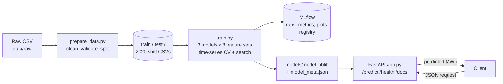
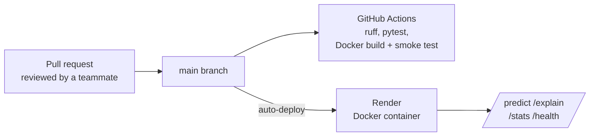
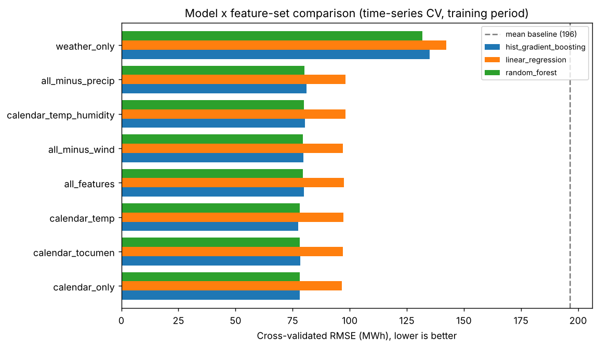
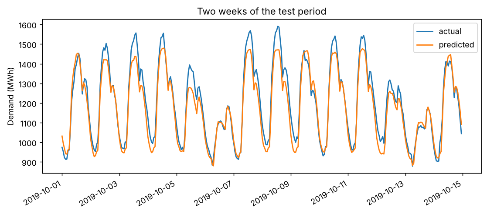

# Energy Demand Forecasting: MLOps Project (Milestones 1 and 2)

A reproducible pipeline that trains and serves a regression model predicting **hourly national electricity demand (MWh) for Panama** from weather and calendar inputs. Milestone 1 covers data preparation, tracked experiments in MLflow, a validated FastAPI service and automated tests. Milestone 2 adds a Docker image, CI on GitHub Actions, deployment on Render, request monitoring (`/stats`) and prediction explanations (`/explain`).

## Architecture



**Delivery pipeline (Milestone 2):**



## Dataset

[Panama short-term electricity load forecasting](https://data.mendeley.com/datasets/byx7sztj59/1) (Aguilar Madrid, 2021): 48,048 hourly rows from Jan 2015 to Jun 2020.

| Group | Columns |
|---|---|
| Target | `nat_demand` (national load, MWh) |
| Weather (12) | temperature `T2M`, humidity `QV2M`, precipitation `TQL`, wind speed `W2M`, each for Tocumen (`_toc`), Santiago (`_san`) and David (`_dav`) |
| Calendar (2 raw + 4 derived) | `holiday`, `school`; derived `hour`, `dayofweek`, `month`, `is_weekend` |

18 model features in total. See [`data/raw/README.md`](data/raw/README.md) for the source, licence note and known quirks (for example `QV2M` is labelled "%" but holds specific humidity in kg/kg).

**Split (chronological, no shuffling):** train 2015-01-03 to 2019-06-30 (39,359 rows), test 2019-07-01 to 2019-12-31 (4,416 rows). Jan to Jun 2020 (4,273 rows) is held out as a distribution-shift check because demand dropped during the COVID-19 lockdown (average demand in March to June 2020 was about 12% below the same months of 2019). It is never used for any modelling decision.

## Quick start

Requires Python 3.11 (the version used by CI and the Docker image).

```bash
python -m venv .venv
source .venv/bin/activate          # Windows: .venv\Scripts\activate
pip install -r requirements-dev.txt

python -m src.prepare_data         # clean, validate, split -> data/processed/
python -m src.train                # full experiment plan, about 5 minutes
mlflow ui --backend-store-uri sqlite:///mlflow.db    # http://127.0.0.1:5000
uvicorn src.app:app --reload       # http://127.0.0.1:8000/docs
pytest                             # 67 tests
ruff check .                       # lint
```

The trained model (`models/model.joblib`) is committed, so the API runs straight after `pip install -r requirements.txt` without retraining. `python -m src.train --quick` runs a tiny smoke version.

## Run with Docker

One command builds the image and one starts the service (needs Docker, no Python install):

```bash
docker build -t energy-api . && docker run -d --name energy-api -p 8000:8000 energy-api
```

Open http://localhost:8000/docs. `docker ps` shows `(healthy)` in the STATUS column once `/health` answers, and `docker logs energy-api` shows one line per request. Stop it with `docker stop energy-api && docker rm energy-api`. The image contains only the code and the trained model, not the data or MLflow.

## Using the API

`POST /predict` returns the predicted demand for one hour. Open `/docs` and use "Try it out", or:

```bash
curl -X POST http://127.0.0.1:8000/predict -H "Content-Type: application/json" -d '{
  "timestamp": "2019-10-15T14:00:00",
  "T2M_toc": 30.1, "T2M_san": 29.4, "T2M_dav": 27.8,
  "QV2M_toc": 0.0189, "QV2M_san": 0.0185, "QV2M_dav": 0.0178,
  "TQL_toc": 0.05, "TQL_san": 0.08, "TQL_dav": 0.10,
  "W2M_toc": 12.0, "W2M_san": 6.5, "W2M_dav": 3.2,
  "holiday": 0, "school": 1
}'
```

```json
{"predicted_demand_mwh": 1501.66, "unit": "MWh", "model_type": "hist_gradient_boosting",
 "feature_set": "calendar_temp", "mlflow_run_id": "..."}
```

| Endpoint | Purpose |
|---|---|
| `POST /predict` | Predict demand. Pydantic rejects missing fields, wrong types, out-of-range values (for example 100 deg C) and unknown fields with HTTP 422. |
| `POST /explain` | Same input as `/predict`. Returns the prediction plus how much each feature pushed it above or below typical demand (see Project Focus). |
| `GET /stats` | Request count, error count, average and maximum latency, per endpoint (see Monitoring) |
| `GET /health` | Liveness and whether the model is loaded (used by Docker and Render) |
| `GET /model-info` | Selected model, features, parameters and metrics |
| `GET /docs` | Auto-generated interactive documentation |

A ready-made request is in [`examples/predict_request.json`](examples/predict_request.json), so the commands are short:

```bash
curl -X POST http://127.0.0.1:8000/predict -H "Content-Type: application/json" -d @examples/predict_request.json
curl -X POST http://127.0.0.1:8000/explain -H "Content-Type: application/json" -d @examples/predict_request.json
curl http://127.0.0.1:8000/stats
```

`/explain` answers with the same prediction and the contributions, largest first (abridged):

```json
{"predicted_demand_mwh": 1501.66, "baseline_mwh": 1168.47, "unit": "MWh", "method": "shapley_exact",
 "contributions": [{"feature": "hour", "value": 14.0, "contribution_mwh": 166.46},
                   {"feature": "dayofweek", "value": 1.0, "contribution_mwh": 83.88},
                   {"feature": "T2M_toc", "value": 30.1, "contribution_mwh": 54.46}, "..."]}
```

The API accepts all raw inputs and derives `hour`, `dayofweek`, `month` and `is_weekend` itself with the same code used in training (`src/features.py`), then uses only the features the selected model was trained on.

## Monitoring

`GET /stats` reports what the service has done since it started (example values, yours will differ):

```json
{"uptime_seconds": 412.6, "total_requests": 7, "error_requests": 1, "avg_latency_ms": 96.4,
 "max_latency_ms": 201.3,
 "by_endpoint": {"/predict": {"count": 5, "errors": 1, "avg_latency_ms": 12.8},
                 "/explain": {"count": 2, "errors": 0, "avg_latency_ms": 183.9}}}
```

Every request is also written to the log as one line (`POST /predict -> 200 in 12.3 ms`). Health checks, `/stats` and `/docs` are not counted, so platform health pings do not hide real traffic. The counters live in memory and reset when the service restarts or (on Render's free tier) wakes from sleep.

## Deployment (Render)

**Live endpoint:** `https://<your-service>.onrender.com` **(TODO before submission: put the real URL here, or write that the service was shut down after grading to save cost)**

Render builds the `Dockerfile` from the `main` branch, uses `/health` as the health check and redeploys on every merge. Setup, redeployment and rollback steps are in [`RUNBOOK.md`](RUNBOOK.md). Example requests against the deployed service:

```bash
export URL=https://<your-service>.onrender.com
curl $URL/health
curl -X POST $URL/predict -H "Content-Type: application/json" -d @examples/predict_request.json
curl -X POST $URL/explain -H "Content-Type: application/json" -d @examples/predict_request.json
curl $URL/stats
```

Render's free tier spins the service down after 15 minutes without traffic and needs about a minute to wake, so the first request can be slow.

## MLflow experiment design

All runs go to one experiment (`energy-demand-forecasting`, SQLite backend, 36 runs):

| Stage | Runs | What happens |
|---|---|---|
| `exploration` | 1 parent + 25 children | A mean-prediction baseline, then **3 model types** (Linear Regression, Random Forest, Gradient Boosting) x **8 feature sets**. Each is scored with 5-fold expanding-window time-series cross-validation on the training period only. |
| `hyperparameter_search` | 1 parent + 8 children | Random search for the winning model and feature set, one child run per candidate. |
| `final_model` | 1 | Refit the winner on all training data, evaluate **once** on the test period, log plots, the model with signature and input example, and register it in the MLflow Model Registry. |

Every run logs its parameters (model type, feature set, feature list, hyperparameters), several metrics (RMSE as the primary metric, plus MAE, R2 and MAPE), and tags (stage, model type, feature set, dataset, row counts). The final run adds the plots and the data validation report as artifacts.

**Feature sets compared:** `calendar_only`, `weather_only`, `calendar_temp`, `calendar_temp_humidity`, `calendar_tocumen` (one city), `all_minus_wind`, `all_minus_precip`, `all_features`.

**No test-set leakage:** features and models are chosen with cross-validation on training data only. Scaling and encoding live inside sklearn Pipelines fitted on training folds, and `prepare_data.py` fits nothing.

## Results

Selected model: **Gradient Boosting (`HistGradientBoostingRegressor`) on `calendar_temp`** (calendar features plus the three city temperatures, 9 features).

| Metric | Value |
|---|---|
| Test RMSE (primary) | **92.8 MWh** |
| Test MAE | 77.7 MWh |
| Test R2 | 0.75 |
| Test MAPE | 6.2% |
| Mean-prediction baseline RMSE | 197.6 MWh (the model is 53% better) |
| Cross-validated RMSE (training period) | 77.3 +/- 13.5 MWh |





Full tables are in [`reports/results.md`](reports/results.md); figures for feature importance, residuals and predicted vs actual are in `reports/figures/`.

### What the experiments showed

- **Calendar features carry most of the signal.** `calendar_only` reaches a CV RMSE of about 78 MWh, while `weather_only` stays near 132 to 142 MWh. Hour of day and day of week are by far the most important features, followed by Tocumen temperature.
- **More features did not help.** Humidity, rainfall and wind added no measurable gain. Differences between the best feature sets (77 to 80 MWh) are smaller than the fold-to-fold spread (about 14 MWh), so the choice among them is not statistically meaningful. We kept the lowest-scoring one.
- **Tree models beat Linear Regression** (about 78 vs about 97 MWh), because the demand pattern is non-linear in hour and temperature.
- **Test error (92.8) is higher than CV error (77.3).** The Jul to Dec 2019 period is harder, and demand grows over the years while tree models cannot predict above the range they saw in training. The plot shows the highest peaks being under-predicted.
- **Distribution shift is visible.** On Jan to Jun 2020 the same model reaches RMSE 157.8 MWh and R2 0.20, which motivates the monitoring planned for Milestone 2.

## Project Focus

We go deep on two areas instead of wide.

### Focus 1: extensive MLflow experimentation and model comparison

- **Why it suits this project:** the dataset has 18 features in natural groups (calendar, temperature, humidity, rainfall, wind, three cities), and the interesting question is which of them matter. A single run could not answer that.
- **What we built (Milestone 1):** 36 tracked runs. A baseline, 3 model types x 8 feature sets with time-series cross-validation, a random hyperparameter search, and a final run evaluated once on the test period (see the MLflow section and Results).
- **What we will add for the final submission:** an experiment with a time-trend feature to address the under-predicted peaks, logged in MLflow and compared with the current best model, plus the global feature-importance plot logged with the final run.
- **How we demonstrate it:** the MLflow UI (run table, parameters, metrics, charts), `reports/results.md` and the model comparison chart.

### Focus 2: explainability (`/explain`)

- **Why it suits this project:** a grid operator will only trust a demand forecast if it can see why the model predicts it. Here the answer is simple and checkable: hour of day and day of week explain most of the variation, and temperature adds a smaller effect.
- **What we built:** `POST /explain` takes the same input as `/predict` and returns the baseline (the average prediction over typical training hours) and one contribution per feature in MWh, so that `prediction = baseline + sum of contributions`.
- **How it works:** exact Shapley values (the standard attribution method behind SHAP), computed in `src/explain.py` without extra libraries. For the 9 features of the selected model this is 512 feature subsets x 50 background rows = 25,600 model evaluations in one vectorised call. The 50 background rows are a fixed random sample of training data stored in `models/background.json`. Tests check the code against a model whose Shapley values are known in closed form, and check that contributions add up.
- **How we demonstrate it:** call `/explain` for 3 am, 2 pm and a Saturday. The hour contribution flips from clearly negative to clearly positive, and the weekend lowers demand, which matches the daily and weekly cycle in the data.
- **Limits:** the explanation describes the model, not real-world causes. Features that move together (for example the three city temperatures) share credit, and some feature combinations tested during the calculation can be unusual. `/explain` is much slower than `/predict` because it evaluates the model 25,600 times per request: roughly 0.2 s on a fast machine and 0.6 s on a student laptop in our tests, against a few to 70 ms for `/predict`.
- **Next steps:** show the contributions as a chart in the final demo and add drift monitoring that compares incoming data with the training sample, motivated by the 2020 results.

## Tests and CI

`pytest` runs 67 tests covering feature engineering, data preparation (duplicates, missing values, out-of-range values, long gaps, chronological split), model loading and prediction sanity (including "the model beats the baseline"), the API (valid and invalid requests, 503 when the model is missing, `/docs`), request monitoring (counts, latency, errors, thread safety), the explanations (exact Shapley values against a known closed form, contributions that add up) and an end-to-end quick training run. `ruff check .` and `ruff format --check .` pass.

GitHub Actions (`.github/workflows/ci.yml`) runs on every push and pull request, and on release tags:

| Job | What it does |
|---|---|
| `lint` | `ruff check` and `ruff format --check` |
| `test` | `pytest` on Python 3.11 |
| `build` | Builds the Docker image, waits until Docker reports it healthy, then calls `/health`, `/predict`, `/explain` and `/stats` on the running container |

`build` only runs after `lint` and `test` pass.

## Repository layout

```
src/
  config.py         paths, split dates, valid ranges, feature sets
  features.py       time features shared by training and serving
  prepare_data.py   clean, validate and split the raw data
  train.py          MLflow experiment plan and model selection
  model.py          load the model, predict and explain one row
  explain.py        exact Shapley values for /explain, background sample
  monitoring.py     request counters and latency for /stats
  app.py            FastAPI service
tests/              pytest suite (67 tests)
data/raw/           raw dataset + source notes
models/             model.joblib, model_meta.json, background.json
reports/            results.md, CSV tables, figures
examples/           ready-made request for the cURL examples
.github/workflows/  CI pipeline
Dockerfile          container image (Python 3.11)
RUNBOOK.md          run, deploy, redeploy and roll back
AI_USAGE.md         AI tools used and how we reviewed their output
```

## Limitations and next steps

- Weather inputs are required at prediction time, so true forecasting needs weather forecasts as inputs.
- No trend or lag features yet, so growth over time is not captured (see the under-predicted peaks).
- One chronological test split; no confidence intervals.
- Monitoring is in memory only. It resets on restart and is not shared between several instances.
- Drift detection is not built yet (planned as a next step, see Project Focus).

## Team

Muhammad Zain Chinoy (ERP 29059), Areeba Salman (ERP 29075) and Abdullah Feroz (ERP 29219). See [`CONTRIBUTION.md`](CONTRIBUTION.md) for who did what and [`AI_USAGE.md`](AI_USAGE.md) for how we used AI tools. Licensed under the [MIT License](LICENSE).

## Credits and open-source components

- **Dataset:** Aguilar Madrid, Ernesto (2021), "Short-term electricity load forecasting (Panama case study)", Mendeley Data, V1, doi: 10.17632/byx7sztj59.1.
- **Libraries:** [scikit-learn](https://scikit-learn.org), [pandas](https://pandas.pydata.org), [NumPy](https://numpy.org), [joblib](https://joblib.readthedocs.io), [matplotlib](https://matplotlib.org), [MLflow](https://mlflow.org), [FastAPI](https://fastapi.tiangolo.com), [Pydantic](https://docs.pydantic.dev), [uvicorn](https://www.uvicorn.org), [pytest](https://pytest.org), [HTTPX](https://www.python-httpx.org) and [Ruff](https://docs.astral.sh/ruff/).
- **Tools and services:** Docker, GitHub Actions, Render.
- **Method:** Shapley values (L. S. Shapley, 1953) as popularised for machine learning by SHAP (Lundberg and Lee, 2017). Our implementation in `src/explain.py` is our own and does not use the `shap` package.
- No code was copied from other groups or public repositories. AI assistance is documented in `AI_USAGE.md`.
