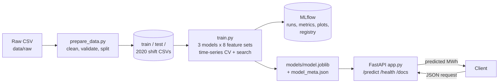
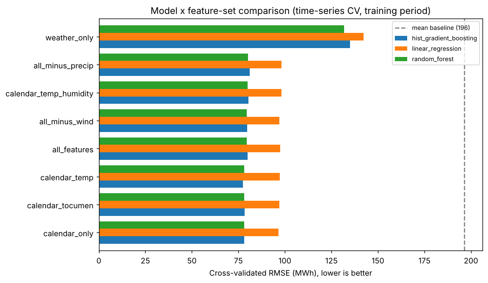
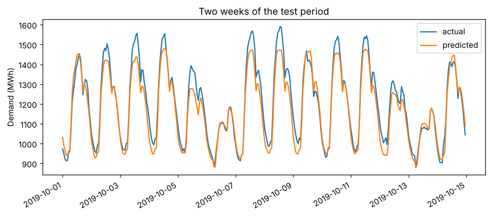

# Energy Demand Forecasting: MLOps Project (Milestone 1)

A reproducible pipeline that trains and serves a regression model predicting **hourly national electricity demand (MWh) for Panama** from weather and calendar inputs. Milestone 1 covers data preparation, tracked experiments in MLflow, a validated FastAPI service and automated tests. Milestone 2 adds Docker, CI/CD, deployment and monitoring.

## Architecture



## Dataset

[Panama short-term electricity load forecasting](https://data.mendeley.com/datasets/byx7sztj59/1) (Aguilar Madrid, 2021): 48,048 hourly rows from Jan 2015 to Jun 2020.

| Group | Columns |
|---|---|
| Target | `nat_demand` (national load, MWh) |
| Weather (12) | temperature `T2M`, humidity `QV2M`, precipitation `TQL`, wind speed `W2M`, each for Tocumen (`_toc`), Santiago (`_san`) and David (`_dav`) |
| Calendar (2 raw + 4 derived) | `holiday`, `school`; derived `hour`, `dayofweek`, `month`, `is_weekend` |

18 model features in total. See [`data/raw/README.md`](data/raw/README.md) for the source, licence note and known quirks (for example `QV2M` is labelled "%" but holds specific humidity in kg/kg).

**Split (chronological, no shuffling):** train 2015-01-03 to 2019-06-30 (39,359 rows), test 2019-07-01 to 2019-12-31 (4,416 rows). Jan to Jun 2020 (4,273 rows) is held out as a distribution-shift check because demand dropped about 15% during the COVID-19 lockdown. It is never used for any modelling decision.

## Quick start

Requires Python 3.11 or newer.

```bash
python -m venv .venv
source .venv/bin/activate          # Windows: .venv\Scripts\activate
pip install -r requirements-dev.txt

python -m src.prepare_data         # clean, validate, split -> data/processed/
python -m src.train                # full experiment plan, about 5 minutes
mlflow ui --backend-store-uri sqlite:///mlflow.db    # http://127.0.0.1:5000
uvicorn src.app:app --reload       # http://127.0.0.1:8000/docs
pytest                             # 42 tests
ruff check .                       # lint
```

The trained model (`models/model.joblib`) is committed, so the API runs straight after `pip install -r requirements.txt` without retraining. `python -m src.train --quick` runs a tiny smoke version.

## Using the API

`POST /predict` returns the predicted demand for one hour. Open `/docs` and use "Try it out", or:

```bash
curl -X POST http://127.0.0.1:8000/predict -H "Content-Type: application/json" -d '{
  "timestamp": "2019-10-15T14:00:00",
  "T2M_toc": 30.1, "T2M_san": 29.4, "T2M_dav": 27.8,
  "QV2M_toc": 0.0189, "QV2M_san": 0.0185, "QV2M_dav": 0.0178,
  "TQL_toc": 0.05, "TQL_san": 0.08, "TQL_dav": 0.10,
  "W2M_toc": 12.0, "W2M_san": 6.5, "W2M_dav": 3.2,
  "holiday": 0, "school": 1
}'
```

```json
{"predicted_demand_mwh": 1501.66, "unit": "MWh", "model_type": "hist_gradient_boosting",
 "feature_set": "calendar_temp", "mlflow_run_id": "..."}
```

| Endpoint | Purpose |
|---|---|
| `POST /predict` | Predict demand. Pydantic rejects missing fields, wrong types, out-of-range values (for example 100 deg C) and unknown fields with HTTP 422. |
| `GET /health` | Liveness and whether the model is loaded |
| `GET /model-info` | Selected model, features, parameters and metrics |
| `GET /docs` | Auto-generated interactive documentation |

The API accepts all raw inputs and derives `hour`, `dayofweek`, `month` and `is_weekend` itself with the same code used in training (`src/features.py`), then uses only the features the selected model was trained on.

## MLflow experiment design

All runs go to one experiment (`energy-demand-forecasting`, SQLite backend, 36 runs):

| Stage | Runs | What happens |
|---|---|---|
| `exploration` | 1 parent + 25 children | A mean-prediction baseline, then **3 model types** (Linear Regression, Random Forest, Gradient Boosting) x **8 feature sets**. Each is scored with 5-fold expanding-window time-series cross-validation on the training period only. |
| `hyperparameter_search` | 1 parent + 8 children | Random search for the winning model and feature set, one child run per candidate. |
| `final_model` | 1 | Refit the winner on all training data, evaluate **once** on the test period, log plots, the model with signature and input example, and register it in the MLflow Model Registry. |

Every run logs its parameters (model type, feature set, feature list, hyperparameters), several metrics (RMSE as the primary metric, plus MAE, R2 and MAPE), and tags (stage, model type, feature set, dataset, row counts). The final run adds the plots and the data validation report as artifacts.

**Feature sets compared:** `calendar_only`, `weather_only`, `calendar_temp`, `calendar_temp_humidity`, `calendar_tocumen` (one city), `all_minus_wind`, `all_minus_precip`, `all_features`.

**No test-set leakage:** features and models are chosen with cross-validation on training data only. Scaling and encoding live inside sklearn Pipelines fitted on training folds, and `prepare_data.py` fits nothing.

## Results

Selected model: **Gradient Boosting (`HistGradientBoostingRegressor`) on `calendar_temp`** (calendar features plus the three city temperatures, 9 features).

| Metric | Value |
|---|---|
| Test RMSE (primary) | **92.8 MWh** |
| Test MAE | 77.7 MWh |
| Test R2 | 0.75 |
| Test MAPE | 6.2% |
| Mean-prediction baseline RMSE | 197.6 MWh (the model is 53% better) |
| Cross-validated RMSE (training period) | 77.3 +/- 13.5 MWh |





Full tables are in [`reports/results.md`](reports/results.md); figures for feature importance, residuals and predicted vs actual are in `reports/figures/`.

### What the experiments showed

- **Calendar features carry most of the signal.** `calendar_only` reaches a CV RMSE of about 78 MWh, while `weather_only` stays near 132 to 142 MWh. Hour of day and day of week are by far the most important features, followed by Tocumen temperature.
- **More features did not help.** Humidity, rainfall and wind added no measurable gain. Differences between the best feature sets (77 to 80 MWh) are smaller than the fold-to-fold spread (about 14 MWh), so the choice among them is not statistically meaningful. We kept the lowest-scoring one.
- **Tree models beat Linear Regression** (about 78 vs about 97 MWh), because the demand pattern is non-linear in hour and temperature.
- **Test error (92.8) is higher than CV error (77.3).** The Jul to Dec 2019 period is harder, and demand grows over the years while tree models cannot predict above the range they saw in training. The plot shows the highest peaks being under-predicted.
- **Distribution shift is visible.** On Jan to Jun 2020 the same model reaches RMSE 157.8 MWh and R2 0.20, which motivates the monitoring planned for Milestone 2.

## Tests and linting

`pytest` runs 42 tests covering feature engineering, data preparation (duplicates, missing values, out-of-range values, long gaps, chronological split), model loading and prediction sanity (including "the model beats the baseline"), the API (valid and invalid requests, 503 when the model is missing, `/docs`) and an end-to-end quick training run. `ruff check .` and `ruff format --check .` pass.

## Repository layout

```
src/
  config.py         paths, split dates, valid ranges, feature sets
  features.py       time features shared by training and serving
  prepare_data.py   clean, validate and split the raw data
  train.py          MLflow experiment plan and model selection
  model.py          load the model and predict one row
  app.py            FastAPI service
tests/              pytest suite
data/raw/           raw dataset + source notes
models/             model.joblib, model_meta.json (selected model)
reports/            results.md, CSV tables, figures
```

## Limitations and next steps

- Weather inputs are required at prediction time, so true forecasting needs weather forecasts as inputs.
- No trend or lag features yet, so growth over time is not captured (see the under-predicted peaks).
- One chronological test split; no confidence intervals.
- **Milestone 2:** Dockerfile and `/health` check, GitHub Actions (ruff, pytest, Docker build), deployment on Render or AWS App Runner, request and latency monitoring, `RUNBOOK.md`, `AI_USAGE.md`.

## Team

Muhammad Zain Chinoy (ERP 29059) and Areeba Salman (ERP 29075). See [`CONTRIBUTION.md`](CONTRIBUTION.md). Licensed under the [MIT License](LICENSE).
